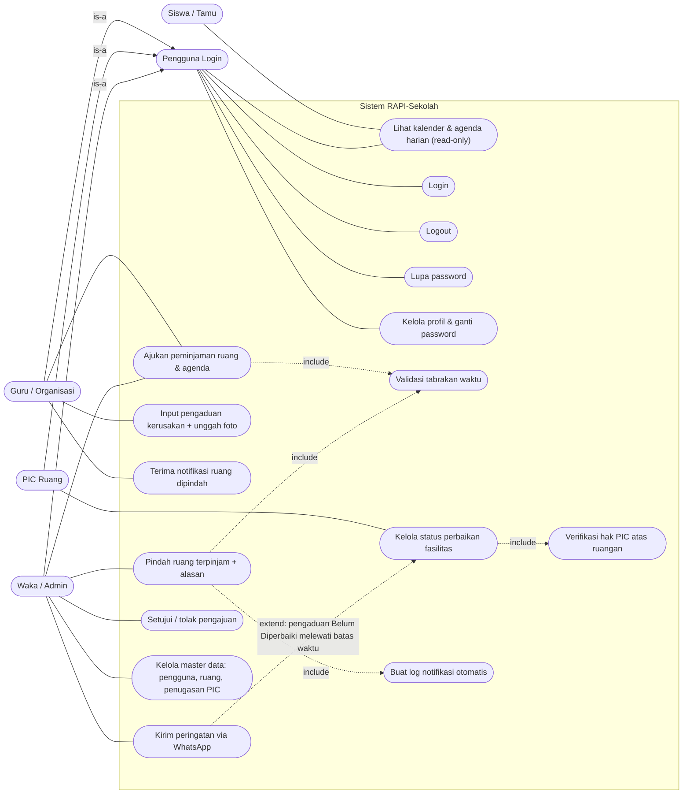
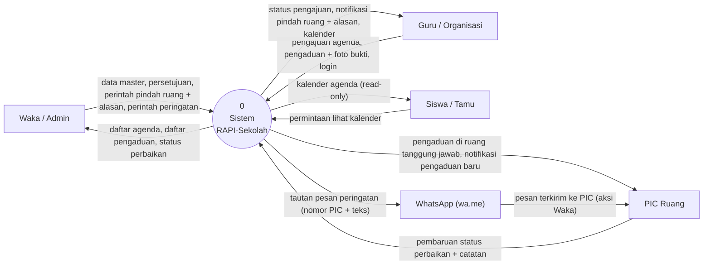
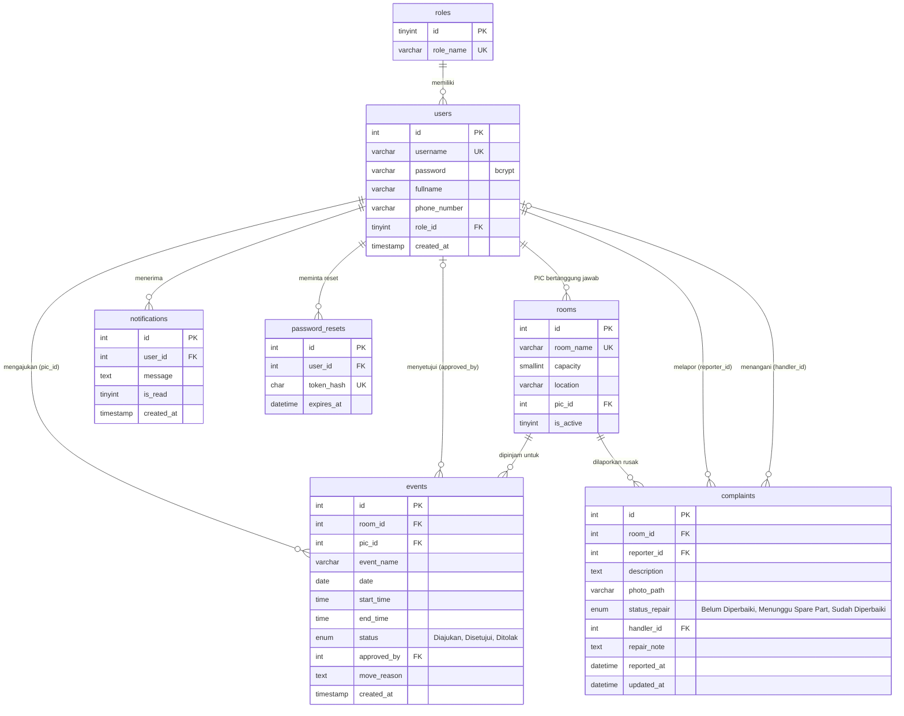
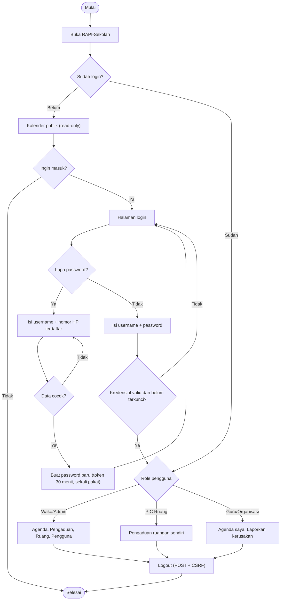
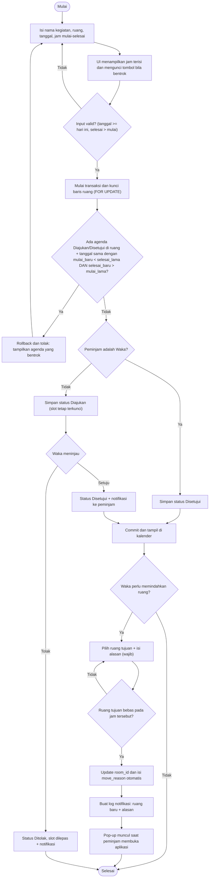
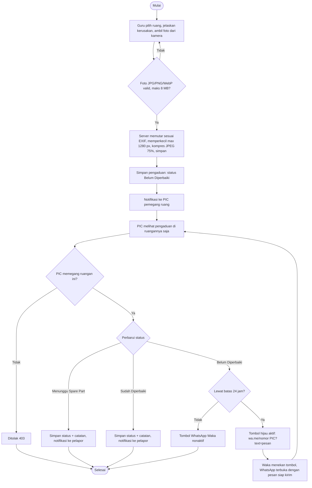

# Diagram Perancangan RAPI-Sekolah

Berisi: Use Case Diagram, DFD Level 0 (Diagram Konteks), ERD, dan tiga Flowchart alur utama.

## 1. Use Case Diagram

## 2. DFD Level 0 (Diagram Konteks)

## 3. ERD (Entity Relationship Diagram)

Tabel `notifications` dan `password_resets` adalah tambahan di luar 5 tabel wajib, untuk log notifikasi otomatis dan fitur lupa password.

## 4. Flowchart

### 4a. Alur masuk dan hak akses

### 4b. Peminjaman ruang dan override Waka

### 4c. Pengaduan kerusakan dan eskalasi WhatsApp

